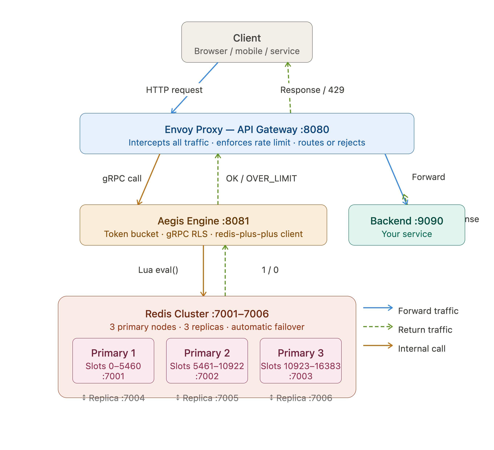

# Aegis Engine

**Envoy API Gateway with Custom Token Bucket Rate Limiting, redis-plus-plus Client, and Redis Cluster High Availability**

| | |
|---|---|
| **Status** | Draft |
| **Reviewers** | Engineering, Architecture, Platform |
| **Last Updated** | November 2026 |
| **Version** | 2.1 |
| **Changes from v2.0** | Sliding Window algorithm, per-route rules via `ConfigProvider`, `RateLimitDecision` with response headers, one shared Redis client with timeouts, Envoy client-IP hardening |
| **Changes from v1.0** | Added Redis Cluster topology, redis-plus-plus client, cluster failover, Bazel `local_path_override` setup |

---

## Table of Contents

1. [Overview](#1-overview)
2. [Goals & Non-Goals](#2-goals--non-goals)
3. [System Architecture](#3-system-architecture)
4. [Request Flow](#4-request-flow)
5. [Rate Limiting Algorithm](#5-rate-limiting-algorithm)
6. [redis-plus-plus Client](#6-redis-plus-plus-client)
7. [Redis Cluster](#7-redis-cluster)
8. [Envoy Integration](#8-envoy-integration)
9. [Build System](#9-build-system)
10. [Deployment](#10-deployment)
11. [Testing](#11-testing)
12. [Future Work](#12-future-work)
13. [Glossary](#13-glossary)

---

## 1. Overview

Aegis Engine is a distributed rate limiting service built in C++ that integrates with Envoy Proxy as an API Gateway. Rather than relying on Envoy's built-in rate limiting, Aegis Engine implements custom Token Bucket and Sliding Window algorithms backed by a Redis Cluster, exposed to Envoy via the gRPC-based External Rate Limit Service (RLS) protocol. Each route can use its own rule (for example, a strict limit on login).

This version (v2.0) updates the design to reflect the decision to use **redis-plus-plus** as the Redis client library, which provides built-in Redis Cluster support including automatic slot routing, MOVED/ASK redirect handling, and connection pooling across all cluster nodes. This replaces the previously described plain hiredis approach.

---

## 2. Goals & Non-Goals

### 2.1 Goals

- Enforce distributed rate limits consistently across multiple application servers.
- Implement the Token Bucket algorithm with atomic Redis-backed Lua scripting.
- Integrate with Envoy Proxy via the standard External RLS gRPC protocol.
- Support pluggable rate limiting algorithms (Leaky Bucket, Sliding Window) via a common abstract interface.
- Achieve high availability via Redis Cluster with 3 primary nodes and 3 replicas and automatic failover.
- Use redis-plus-plus as the Redis client for built-in cluster-aware routing.
- Build with reproducible Bazel builds using Bzlmod and C++17.

### 2.2 Non-Goals

- Aegis Engine does not implement authentication or authorization.
- Aegis Engine does not handle TLS termination — that is Envoy's responsibility.
- This document does not cover the backend services behind the API gateway.

---

## 3. System Architecture

The system is composed of four layers that work together to intercept, evaluate, and enforce rate limits on every incoming request.



### 3.1 Component Summary

| Component | Technology | Responsibility |
|---|---|---|
| API Gateway | Envoy Proxy | Intercepts all traffic, calls Aegis Engine via gRPC before routing |
| Rate Limiter | C++ / Aegis Engine | Implements RLS gRPC interface, applies the algorithm configured for the request's rule |
| Rule Config | `ConfigProvider` | Maps a rule name (`login`, `payment`, ...) to an algorithm and its limits. Phase 1: in-memory map; Phase 2: DynamoDB |
| Redis Client | redis-plus-plus | Cluster-aware C++ client — slot routing, MOVED/ASK, connection pooling. One shared client per Aegis process |
| Token Store | Redis Cluster | 6-node cluster storing rate-limit state atomically per IP + rule key |
| Algorithms | Token Bucket, Sliding Window + Lua | Atomic check-and-update via Redis Lua scripting |
| Build System | Bazel + Bzlmod | Reproducible builds, `local_path_override` for redis-plus-plus |

---

## 4. Request Flow

The following steps describe the lifecycle of a single incoming request through the system:

1. Client sends an HTTP request to Envoy on port 8080.
2. Envoy matches the route (`/api/login`, `/api/payment`, `/api`, `/health`, `/`) and its `ratelimit` HTTP filter intercepts the request before routing.
3. Envoy calls Aegis Engine's `ShouldRateLimit()` gRPC method with one descriptor containing two entries: the client's `remote_address` (IP) and a `request_type` naming the route's rule (e.g. `login`).
4. `aegis_grpc_server.cpp` extracts the IP and the rule name, and builds the Redis key `"ip:<ip>:<rule>"`, e.g. `"ip:203.0.113.42:login"`.
5. It asks `ConfigProvider` for that rule's config and builds a limiter of the configured algorithm (`TokenBucket` or `SlidingWindow`). Building one is cheap, so a new limiter is made per request.
6. `limiter->consume(key)` runs the algorithm's Lua script with `cluster_.eval()` on the shared redis-plus-plus client.
7. redis-plus-plus computes the CRC16 hash slot for the key, looks up the owning primary node, and routes the EVAL command to that specific node automatically.
8. The Lua script runs atomically on the Redis primary node, using Redis's own clock (`TIME`), and returns `{allowed, remaining, retry_after_seconds}`.
9. Aegis Engine sets the gRPC response to `OK` or `OVER_LIMIT`, adds an `X-RateLimit-Remaining` header, and, when over the limit, an `X-RateLimit-RetryAfter` header.
10. If `OK`: Envoy routes the request to the backend. If `OVER_LIMIT`: Envoy returns HTTP `429 Too Many Requests` with those headers.

If Redis can't be reached or a script fails, Aegis Engine **fails open**: the request is allowed and no `X-RateLimit-Remaining` header is sent.

---

## 5. Rate Limiting Algorithm

### 5.1 Abstract Interface

All rate limiting algorithms implement the `RateLimiter` abstract base class, allowing Aegis Engine to swap algorithms without changing the gRPC server or any other component:

```cpp
struct RateLimitDecision {
    bool allowed;              // let the request through?
    int  remaining;            // requests/tokens left; -1 when unknown (failed open)
    int  retry_after_seconds;  // when a rejected caller can retry; 0 when allowed
};

class RateLimiter {
public:
    virtual ~RateLimiter() = default;

    // `key` is the Redis key for this caller, e.g. "ip:203.0.113.42:login".
    virtual RateLimitDecision consume(const std::string& key, int tokens = 1) = 0;
};
```

A limiter holds only its rule's settings (capacity and rate or window) and a reference to the shared Redis client. It doesn't store a key or any per-caller state, so one limiter can serve every caller of a rule. All per-caller state lives in Redis.

### 5.2 Token Bucket Algorithm

The Token Bucket algorithm allows short bursts up to a configured capacity, then refills at a steady rate. It is the primary algorithm used in production.

| Parameter | Description | Example |
|---|---|---|
| `capacity` | Maximum tokens the bucket can hold | 100 tokens |
| `refill_rate` | Tokens added per second | 10 tokens/sec |
| `tokens` | Current available token count stored in Redis | 74.3 tokens |
| `last_refill` | Unix timestamp of last refill calculation | 1717000000.123 |

### 5.3 Sliding Window Algorithm

The Sliding Window algorithm allows at most `capacity` requests in any rolling window of `window_seconds`. It is used where strict counts matter, such as login attempts. It's implemented as a **sliding window log**: a Redis sorted set with one entry per allowed request, scored by its timestamp in milliseconds.

| Parameter | Description | Example |
|---|---|---|
| `capacity` | Maximum requests allowed in the window | 5 requests |
| `window_seconds` | Length of the rolling window | 60 seconds |
| Sorted set entries | One per allowed request; score = Redis time in ms | `1794179999955` |

Rejected requests are **not** recorded, so hammering a locked-out key doesn't extend the lockout.

### 5.4 Atomic Lua Scripts

Each algorithm's check-and-update runs as one Lua script executed atomically on the Redis primary node. While the script runs, no other Redis command from any server can interleave — preventing race conditions across multiple Aegis Engine instances. Both scripts read the time from Redis (`TIME`), so every Aegis Engine instance uses the same clock.

Token Bucket (`rate-limiting-algorithm/token_bucket.h`, abridged):

```lua
-- KEYS[1] = 'ip:203.0.113.42:default'
-- ARGV: capacity, refill_rate, tokens_requested

local t   = redis.call('TIME')                       -- {seconds, microseconds}
local now = tonumber(t[1]) + tonumber(t[2]) / 1000000

local tokens      = tonumber(redis.call('HGET', key, 'tokens'))      or capacity
local last_refill = tonumber(redis.call('HGET', key, 'last_refill')) or now

-- Refill: add tokens proportional to elapsed time, capped at capacity
tokens = math.min(capacity, tokens + ((now - last_refill) * refill_rate))

local allowed, retry_after = 0, 0
if tokens >= token_req then
    tokens  = tokens - token_req
    allowed = 1
else
    retry_after = math.ceil((token_req - tokens) / refill_rate)
end

redis.call('HSET', key, 'tokens', tokens)
redis.call('HSET', key, 'last_refill', now)
redis.call('EXPIRE', key, 3600)
return {allowed, math.floor(tokens), retry_after}
```

Sliding Window (`rate-limiting-algorithm/sliding_window.h`, abridged):

```lua
-- KEYS[1] = 'ip:203.0.113.42:login'
-- ARGV: capacity, window_seconds, tokens_requested

local t      = redis.call('TIME')
local now_ms = tonumber(t[1]) * 1000 + math.floor(tonumber(t[2]) / 1000)

redis.call('ZREMRANGEBYSCORE', key, '-inf', now_ms - window_ms)   -- drop expired entries
local count = redis.call('ZCARD', key)

if count + req <= capacity then
    for i = 1, req do                                             -- one unique member per request
        redis.call('ZADD', key, now_ms, t[1] .. ':' .. t[2] .. ':' .. (count + i))
    end
    redis.call('PEXPIRE', key, window_ms)
    return {1, capacity - count - req, 0}
end

-- Rejected: retry when the oldest entry leaves the window
local oldest = redis.call('ZRANGE', key, 0, 0, 'WITHSCORES')
local retry  = math.ceil((oldest[2] + window_ms - now_ms) / 1000)
return {0, capacity - count, math.max(1, retry)}
```

### 5.5 Rules and Redis Key Design

Each Envoy route sends a `request_type` naming its rule. `ConfigProvider` maps the rule to an algorithm and its limits:

| Rule | Route | Algorithm | Limit |
|---|---|---|---|
| `login` | `/api/login` | Sliding Window | 5 requests per 60s |
| `payment` | `/api/payment` | Sliding Window | 10 requests per hour |
| `default_api` | other `/api` paths | Token Bucket | capacity 10, refill 5/s |
| `default` | everything else (`/`) | Token Bucket | capacity 100, refill 10/s |

`/health` has no rate limit. If a request carries no `request_type`, Aegis Engine uses `default`; if it names an unknown rule, a built-in fallback (Token Bucket, capacity 100, refill 10/s) is used.

Only per-caller state is stored in Redis; the rule settings live in `ConfigProvider`:

| Data | Stored Where | Why |
|---|---|---|
| `tokens`, `last_refill` | Redis hash (Token Bucket) | Changes on every request — must be shared across servers |
| Request timestamps | Redis sorted set (Sliding Window) | One entry per allowed request in the window |
| `capacity`, rate / window | `ConfigProvider` | Rule config — same for every caller of a rule |
| TTL | Redis `EXPIRE` / `PEXPIRE` | Auto-cleanup of idle keys: 1 hour (Token Bucket) or one window (Sliding Window) |

Keys follow a namespace convention to support different rate limit scopes:

```
ip:{ip_address}:{rule}                     // per IP per rule (current implementation)
user:{user_id}:{rule}                      // per user (planned)
```

### 5.6 Supported Algorithms

| Algorithm | Burst Behaviour | Best For | Status |
|---|---|---|---|
| Token Bucket | Allows bursts up to capacity | APIs with occasional bursts | ✅ Implemented |
| Sliding Window | Max N requests per rolling time window | Strict request count enforcement (login, payment) | ✅ Implemented |
| Leaky Bucket | No bursts, fixed output rate | Smooth, predictable throughput | 🔲 Planned |

---

## 6. redis-plus-plus Client

### 6.1 Why redis-plus-plus

Plain hiredis was evaluated first but does not support Redis Cluster — it only connects to a single node. Implementing cluster support manually (CRC16 slot calculation, CLUSTER SLOTS topology discovery, MOVED/ASK redirect handling, connection pooling) would require significant custom code with ongoing maintenance risk.

redis-plus-plus provides all of this as a built-in C++ wrapper around hiredis:

| Concern | Plain hiredis (manual) | redis-plus-plus `RedisCluster` |
|---|---|---|
| CRC16 slot calculation | You implement it | Built in |
| CLUSTER SLOTS topology | You implement it | Built in, automatic on connect |
| MOVED redirect handling | You implement it | Built in, transparent |
| ASK redirect (slot migration) | You implement it | Built in |
| Per-node connection pooling | You implement it | Built in |
| Bazel Central Registry | ✅ Available | ❌ Not available — `local_path_override` |
| API style | C structs, manual | Modern C++, type-safe |

### 6.2 How RedisCluster Routes Requests

When a limiter's `consume()` calls `redis_cluster_.eval()`, redis-plus-plus internally performs the following steps transparently:

1. Computes the CRC16 hash of the key (e.g. `"ip:203.0.113.42:login"`) to determine the hash slot (0–16383).
2. Looks up which primary node owns that slot in its cached slot map.
3. Sends the EVAL command directly to that specific node's connection.
4. If the node returns a `MOVED` error (e.g. after a failover), refreshes the slot map and retries automatically.
5. If the node returns an `ASK` error (e.g. during a live slot migration), follows the redirect transparently.

From the perspective of a limiter, this entire process is a single blocking call:

```cpp
// redis-plus-plus handles all routing internally
std::vector<long long> results;
redis_cluster_.eval(
    CONSUME_SCRIPT,
    { key },                                   // KEYS — used to determine the slot
    { std::to_string(capacity_),
      std::to_string(refill_rate_),
      std::to_string(token_requested) },       // ARGV
    std::back_inserter(results)                // {allowed, remaining, retry_after}
);
```

A Redis timeout can make redis-plus-plus refresh its slot map and retry the command once, so a timed-out request may occasionally be counted twice.

### 6.3 One Shared Client

Aegis Engine creates **one** `RedisCluster` at startup in `aegis_engine_main.cc` and passes it by reference to the gRPC service, which passes it to every limiter. Limiters only borrow it; `main()` owns it and keeps it alive for the whole process.

```cpp
sw::redis::ConnectionOptions redis_connection_opts;
redis_connection_opts.host = *redis_hostname;                          // AEGIS_REDIS_URI_HOST
redis_connection_opts.port = std::stoi(*redis_port);                   // AEGIS_REDIS_URI_PORT
redis_connection_opts.connect_timeout = std::chrono::milliseconds(100);
redis_connection_opts.socket_timeout  = std::chrono::milliseconds(100);

sw::redis::ConnectionPoolOptions redis_connection_pool_opts;
redis_connection_pool_opts.size = 16;                                  // connections per primary
redis_connection_pool_opts.wait_timeout = std::chrono::milliseconds(50);

auto redisCluster = std::make_unique<sw::redis::RedisCluster>(
    redis_connection_opts, redis_connection_pool_opts);               // connects + discovers topology HERE

RateLimitServiceImpl service(configProvider, *redisCluster);
```

- **Timeouts:** without them, a Redis node that stops answering blocks a request until the OS gives up (about 70s). With them, a call fails fast and Aegis Engine fails open.
- **Pool:** gRPC worker threads share the pooled connections, so the number of Redis connections stays fixed no matter how many clients call Aegis.
- **Startup:** if the first connection fails, Aegis Engine logs the error and exits; Docker Compose restarts it (`restart: on-failure`).
- **Reconnects:** broken connections are reconnected automatically the next time they're taken from the pool. No reconnect code is needed in Aegis.
- **No destructor needed:** when `main()` exits, `RedisCluster`'s own destructor closes all pooled connections.

---

## 7. Redis Cluster

### 7.1 Topology

Redis Cluster is deployed as 6 Docker containers — 3 primary nodes and 3 replicas. Each primary owns a shard of the 16,384 hash slots. Keys are deterministically assigned to a slot via CRC16, and each slot is owned by exactly one primary at any time.

| Compose Service | Container | Role | IP Address | Host Port | Hash Slots |
|---|---|---|---|---|---|
| redis-node-1 | token-store-master-1 | Primary | 172.20.0.11 | 7001 | 0 – 5460 |
| redis-node-2 | token-store-master-2 | Primary | 172.20.0.12 | 7002 | 5461 – 10922 |
| redis-node-3 | token-store-master-3 | Primary | 172.20.0.13 | 7003 | 10923 – 16383 |
| redis-node-4 | token-store-replica-1 | Replica | 172.20.0.14 | 7004 | Replicates one primary |
| redis-node-5 | token-store-replica-2 | Replica | 172.20.0.15 | 7005 | Replicates one primary |
| redis-node-6 | token-store-replica-3 | Replica | 172.20.0.16 | 7006 | Replicates one primary |

`redis-cli --cluster create` decides which replica follows which primary. To see the current mapping:

```bash
docker exec token-store-master-1 redis-cli cluster nodes
```

All nodes share one config file, `aegis-engine/redis/redis.conf` (`cluster-enabled yes`, `cluster-node-timeout 5000`, `appendonly yes`), mounted into each container. It configures the Redis servers only; Aegis Engine never reads it.

### 7.2 Cluster Bootstrap

The cluster is initialised by a one-shot `redis-cluster-init` container in Docker Compose. It starts after the 6 node containers, waits 5 seconds (`sleep 5`), then runs:

```bash
redis-cli --cluster create \
    172.20.0.11:6379  172.20.0.12:6379  172.20.0.13:6379 \
    172.20.0.14:6379  172.20.0.15:6379  172.20.0.16:6379 \
    --cluster-replicas 1 --cluster-yes
```

### 7.3 Failover Behaviour

When a primary node fails, Redis Cluster's internal gossip protocol detects the failure and promotes the corresponding replica automatically. The sequence is:

1. A primary node (e.g. `token-store-master-1`) stops responding.
2. Remaining nodes detect failure via gossip within `cluster-node-timeout` (5 seconds, set in `redis.conf`).
3. The replica of the failed primary is promoted to primary.
4. redis-plus-plus receives a `MOVED` error on the next command to the failed node.
5. redis-plus-plus automatically re-fetches `CLUSTER SLOTS`, updates its slot map, and retries the command against the newly promoted node.
6. Your C++ code sees no error — the retry is transparent.

During the failover window (up to 5 seconds), commands to the affected slot range may fail. Aegis Engine handles this by failing open:

```cpp
catch (const sw::redis::Error& e) {
    std::cerr << "[token_bucket] Redis cluster error: " << e.what()
              << " --failing open\n";
    return {true, -1, 0};   // allowed, remaining unknown, no retry-after
}
```

`ShouldRateLimit` also wraps limiter creation and `consume()` in a `try`/`catch` of `std::exception`, so any other error fails open too.

### 7.4 Docker Network Configuration

All services run on one Docker bridge network, and the 6 Redis nodes have fixed IP addresses. Fixed IPs are critical because Redis Cluster nodes store each other's addresses in their cluster config — if IPs changed on restart, nodes would lose track of each other.

```yaml
networks:
  aegis-network:
    driver: bridge
    ipam:
      config:
        - subnet: 172.20.0.0/16
```

Aegis Engine finds the cluster through environment variables set in `docker-compose.yaml`; any one node works as the entry point:

```yaml
  aegis_engine:
    environment:
      AEGIS_REDIS_URI_HOST: "172.20.0.11"   # must match redis-node-1's ipv4_address
      AEGIS_REDIS_URI_PORT: "6379"
```

The nodes advertise their internal `172.20.0.x` addresses, which a Mac host can't reach. Anything that talks to the cluster (Aegis Engine, the tests) has to run on `aegis-network`.

### 7.5 Graceful Shutdown

| Command | Stops | Removes Containers | Removes Data |
|---|---|---|---|
| `docker compose stop --timeout 30` | Yes | No | No — data preserved on volumes |
| `docker compose down` | Yes | Yes | No — data preserved on volumes |
| `docker compose down -v` | Yes | Yes | Yes — full reset |

---

## 8. Envoy Integration

### 8.1 External Rate Limit Service Protocol

Envoy communicates with Aegis Engine using the standard External RLS gRPC protocol. The `.proto` file is downloaded from Envoy's official GitHub repository and compiled with `protoc` at build time via Bazel's `cpp_grpc_library` rule. Aegis Engine implements the `ShouldRateLimit` RPC:

```protobuf
service RateLimitService {
    rpc ShouldRateLimit(RateLimitRequest)
        returns (RateLimitResponse);
}
```

### 8.2 IP- and Route-Based Rate Limiting

Each route in `gateway/config/envoy.yaml` sends the client's IP and the route's rule name as one descriptor:

```yaml
# envoy.yaml (the /api/login route)
- match:
    path_separated_prefix: "/api/login"
  route:
    cluster: backend_cluster
    rate_limits:
      - actions:
        - remote_address: {}               # { key: 'remote_address', value: '203.0.113.42' }
        - generic_key:
            descriptor_key: request_type   # { key: 'request_type', value: 'login' }
            descriptor_value: login
```

Routes are matched in order, first match wins, so the specific routes come before `/api` and the catch-all `/`. The listener also normalizes paths (`normalize_path`, `merge_slashes`), so variants like `//api//login` still match the login rule.

Aegis Engine's gRPC server unpacks the descriptor and builds the Redis key:

```cpp
std::string RateLimitServiceImpl::extract_ip(const RateLimitRequest* request) {
    for (const auto& descriptor : request->descriptors())
        for (const auto& entry : descriptor.entries())
            if (entry.key() == "remote_address")
                return entry.value();   // "203.0.113.42"
    return "";
}

std::string RateLimitServiceImpl::build_bucket_key_from_ip(const std::string& ip,
                                                           const std::string& config_key) {
    return "ip:" + ip + ":" + config_key;   // "ip:203.0.113.42:login"
}
```

### 8.3 Trusting the Client IP

`remote_address` is only trustworthy if clients can't fake it. The listener sets:

```yaml
use_remote_address: true        # use the IP of the TCP connection, not a client-sent X-Forwarded-For
internal_address_config:        # treat no real client as internal
  cidr_ranges:
    - address_prefix: 192.0.2.1 # reserved address that never connects
      prefix_len: 32
```

- `use_remote_address: true` stops a client from picking its own rate-limit key by sending a fake `X-Forwarded-For` header.
- `internal_address_config` with a single unused address means every client is "external", so client-supplied `x-envoy-*` control headers are stripped. An empty list would fall back to all private ranges.
- This assumes clients connect to Envoy directly. If a load balancer is added in front, set `xff_num_trusted_hops` to the number of trusted proxies.

### 8.4 Response Construction

Aegis Engine constructs the gRPC response back to Envoy with the rate limit decision and headers:

```cpp
if (decision.remaining >= 0) {          // -1 means unknown (failed open): no header
    auto* remaining_header = response->add_response_headers_to_add();
    remaining_header->set_key("X-RateLimit-Remaining");
    remaining_header->set_value(std::to_string(decision.remaining));
}

if (decision.allowed) {
    response->set_overall_code(RateLimitResponse::OK);
} else {
    response->set_overall_code(RateLimitResponse::OVER_LIMIT);
    // tell the client when to retry
    auto* retry_header = response->add_response_headers_to_add();
    retry_header->set_key("X-RateLimit-RetryAfter");
    retry_header->set_value(std::to_string(decision.retry_after_seconds));
}
```

### 8.5 Envoy Failure Mode

If Aegis Engine is unreachable or doesn't answer within `timeout: 0.25s`, Envoy's behaviour is controlled by `failure_mode_deny` in `envoy.yaml`. This is set to `false` (fail open) so a brief Aegis outage does not take down the entire API:

```yaml
timeout: 0.25s             # give up on Aegis after 250ms
failure_mode_deny: false   # false = fail open (allow), true = fail closed (deny all)
```

---

## 9. Build System

### 9.1 Bazel with Bzlmod

The project uses Bazel 8 with Bzlmod (`MODULE.bazel`) for dependency management. There is no `WORKSPACE` file: Bazel 8 doesn't read one by default, and all dependencies are declared in `MODULE.bazel`.

### 9.2 Dependencies

| Dependency | Version | In BCR? | Purpose |
|---|---|---|---|
| `rules_cc` | 0.0.9 | ✅ Yes | C++ build rules |
| `googletest` | 1.14.0 | ✅ Yes | Unit testing framework |
| `hiredis` | 1.3.0 | ✅ Yes | Redis C client (redis-plus-plus depends on it) |
| `redis-plus-plus` | latest (built from source) | ❌ No | Cluster-aware C++ Redis client — `local_path_override` |
| `grpc` | 1.73.1 | ✅ Yes | RLS protocol transport |
| `protobuf` | 30.0 | ✅ Yes | Serialization for gRPC messages |
| `envoy_api` | 0.0.0-20250128-4de3c74 | ✅ Yes | Envoy's RLS `.proto` definitions |
| `rules_proto` / `rules_proto_grpc_cpp` | 6.0.0 / 5.8.0 | ✅ Yes | `proto_library` and `cpp_grpc_library` rules |

The exact versions are in `aegis-engine/MODULE.bazel`.

### 9.3 redis-plus-plus Bazel Integration

Since redis-plus-plus is not in the Bazel Central Registry, it is built from source and integrated via `local_path_override` in `MODULE.bazel`. The `third_party` directory must live next to `MODULE.bazel` (the Bazel workspace root):

```
aegis-engine/                          ← Bazel workspace root
├── MODULE.bazel                       ← all external dependencies
├── BUILD
├── third_party/
│   └── redis_plus_plus/
│       ├── MODULE.bazel               ← module(name = "redis_plus_plus")
│       ├── BUILD.bazel                ← cc_library pointing to installed .a
│       ├── include/sw/                ← symlink to /usr/local/include/sw
│       └── lib/libredis++.a           ← symlink to /usr/local/lib/libredis++.a
└── *.h / *.cpp
```

`MODULE.bazel`:

```python
module(name = "aegis-engine-main", version = "1.0")

# (gRPC, protobuf and Envoy API deps omitted here; see aegis-engine/MODULE.bazel)
bazel_dep(name = "rules_cc",    version = "0.0.9")
bazel_dep(name = "googletest",  version = "1.14.0")
bazel_dep(name = "hiredis",     version = "1.3.0")
bazel_dep(name = "redis_plus_plus")

local_path_override(
    module_name = "redis_plus_plus",
    path        = "third_party/redis_plus_plus",
)
```

### 9.4 Build Commands

```bash
# install redis-plus-plus from source (run once on each machine)
git clone https://github.com/sewenew/redis-plus-plus.git
cd redis-plus-plus && mkdir build && cd build
cmake .. -DCMAKE_PREFIX_PATH=$(brew --prefix hiredis) \
         -DREDIS_PLUS_PLUS_BUILD_TEST=OFF
make && sudo make install

# all Bazel commands run from the workspace root
cd aegis-data-plane/aegis-engine

# build the Aegis Engine binary
bazel build //:aegis-engine-main

# build everything (including the test binaries)
bazel build //...
```

The tests need a live Redis Cluster on the Docker network, so they're run from a container. See [11.2 Running Tests](#112-running-tests).

---

## 10. Deployment

### 10.1 Docker Compose Services

All services are defined in `aegis-data-plane/aegis-engine/docker-compose.yaml`:

| Service | Container | Image | Host Port | Depends On |
|---|---|---|---|---|
| `envoy` | `envoy` | `envoyproxy/envoy:v1.29-latest` | 8080 (traffic), 9901 (admin) | `aegis_engine`, `backend` |
| `aegis_engine` | `aegis_engine` | Custom C++ Docker build | — (8081 on the Docker network only) | `redis-cluster-init` |
| `redis-node-1..6` | `token-store-master-1..3`, `token-store-replica-1..3` | `redis:8.8.0` | 7001–7006 | — |
| `redis-cluster-init` | `token-cluster-init` | `redis:8.8.0` | — | All 6 nodes |
| `backend` | `backend` | `python:3.12-slim` (placeholder HTTP server) | — (9090 on the Docker network only) | — |

`aegis_engine` uses `restart: on-failure`, so if it starts before the cluster is ready, it exits and Docker restarts it. `redis-cluster-init` runs once; on later starts it exits with an error because the cluster already exists, which is expected.

### 10.2 VM Deployment via Docker

Since redis-plus-plus is not in the Bazel Central Registry, it must be built from source on each machine before running the Bazel build. For VM deployments, this is handled in a multi-stage `aegis-engine/Dockerfile`, so the VM itself only needs Docker installed:

- **Stage 1 (`builder`, Ubuntu 22.04):** installs Bazelisk, builds hiredis **1.3.0** from source (the same version Bazel's `@hiredis` uses, so both agree on struct layouts; apt's `libhiredis-dev` is an incompatible older version), builds and installs redis-plus-plus, copies the sources, and runs `bazel build //:aegis-engine-main -c opt`.
- **Stage 2 (runtime, Ubuntu 22.04):** copies only `libredis++` and the `aegis-engine` binary, exposes 8081, and starts the binary.

On the VM, deployment is a single command:

```bash
git clone https://github.com/WillLuong97/rate-limiter.git
cd rate-limiter/aegis-data-plane/aegis-engine
docker compose up -d --build
```

---

## 11. Testing

### 11.1 Unit Test Coverage

The tests are integration tests: they run against the real Redis Cluster. There are three suites (71 tests), in `aegis-engine/test/`:

| Bazel Target | What is Covered |
|---|---|
| `//:token_bucket_test` | Construction and invalid config, use through the `RateLimiter` interface, allow/deny and remaining counts, multi-token requests, retry-after, refill over time capped at capacity, one limiter serving many keys, state surviving a new limiter per request, fail-open on Redis errors, concurrency on one shared client, two replicas sharing state through Redis |
| `//:sliding_window_test` | The same groups for the Sliding Window, plus what's stored in Redis (one sorted-set entry per allowed request, millisecond scores, TTL) and sliding behaviour (slots free up as entries leave the window; rejected requests don't extend a lockout) |
| `//:aegis_grpc_server_test` | `ShouldRateLimit` called directly with Envoy-shaped requests: per-rule limits, `X-RateLimit-Remaining` / `X-RateLimit-RetryAfter` headers, IPs and rules limited independently, `default` and unknown-rule fallback, fail-open when the IP is missing or Redis errors, many new IPs, concurrent callers |

### 11.2 Running Tests

The cluster nodes only advertise internal Docker addresses (`172.20.0.x`), so the tests run in the builder image on the cluster's network. From `aegis-data-plane/aegis-engine`:

```bash
# 1. start the stack and check the cluster is healthy
docker compose up -d
docker exec token-store-master-1 redis-cli cluster info | grep cluster_state
# expected: cluster_state:ok

# 2. run all three suites against your current code
docker run --rm \
  --network aegis-engine_aegis-network \
  -v aegis-bazel-cache:/root/.cache/bazel \
  -v "$PWD":/app:ro \
  -e AEGIS_TEST_REDIS_URI=tcp://172.20.0.11:6379 \
  aegis-builder \
  bazel test //:token_bucket_test //:sliding_window_test //:aegis_grpc_server_test \
    --symlink_prefix=/ --lockfile_mode=off \
    --test_env=AEGIS_TEST_REDIS_URI --test_output=errors --cache_test_results=no
```

Build the `aegis-builder` image once with `docker build --target builder -t aegis-builder .`. If Redis is unreachable, the tests are **skipped** and Bazel still reports `PASSED`, so check for `Redis cluster unreachable` in the output.

[`aegis-data-plane/README.md`](aegis-data-plane/README.md) explains each flag and shows how to run a single test (`--test_filter`), repeat a timing-sensitive test, and list test names.

---

## 12. Future Work

- mTLS between Envoy and Aegis Engine for production security.
- Prometheus metrics endpoint to expose allow/deny rates, available token levels, and Redis cluster latency per node.
- Implement the Leaky Bucket algorithm behind the existing `RateLimiter` abstract interface.
- Per-user rate limiting (per-route rules already exist) by extending the descriptor extraction in `aegis_grpc_server.cpp`.
- Decide how to handle requests that arrive without a client IP; today they fail open.
- Phase 2 `ConfigProvider`: load rules from DynamoDB, managed by the control plane.
- Load testing with k6 or Vegeta to validate throughput and measure the Envoy → Aegis → Redis round trip latency under high concurrency.
- Migration to a managed Redis service (AWS ElastiCache with Cluster Mode, or Google Cloud Memorystore) for production — only the cluster URI changes in code.
- Submit redis-plus-plus to the Bazel Central Registry to eliminate the `local_path_override` requirement.

---

## 13. Glossary

| Term | Definition |
|---|---|
| RLS | Rate Limit Service — Envoy's gRPC protocol for external rate limiters |
| Token Bucket | Rate limiting algorithm allowing bursts up to capacity, refills at a fixed rate |
| Sliding Window | Rate limiting algorithm allowing at most N requests in any rolling time window |
| Descriptor | The key/value entries Envoy sends to the rate limiter for each request (e.g. `remote_address`, `request_type`) |
| `ConfigProvider` | Aegis Engine component that maps a rule name to its algorithm and limits |
| Lua Script | Atomic server-side script executed by Redis to prevent race conditions across servers |
| gRPC | Remote Procedure Call framework using HTTP/2 and Protocol Buffers |
| Protobuf | Protocol Buffers — Google's binary serialization format used by gRPC |
| redis-plus-plus | C++ wrapper around hiredis with built-in Redis Cluster support |
| `RedisCluster` | The redis-plus-plus class that handles slot routing, MOVED/ASK, and connection pooling |
| Hash Slot | One of 16,384 slots that Redis Cluster uses to assign keys to nodes via CRC16 |
| `MOVED` | Redis Cluster error indicating a key's slot has moved to a different node |
| `ASK` | Redis Cluster error during live slot migration — temporary redirect to another node |
| Redis Cluster | Distributed Redis across 3 primary + 3 replica nodes with automatic failover |
| Bzlmod | Bazel's modern dependency system using `MODULE.bazel` instead of `WORKSPACE` |
| `local_path_override` | Bzlmod directive pointing Bazel to a local directory for a module not in the BCR |
| `OVER_LIMIT` | gRPC response code telling Envoy to return HTTP 429 to the client |
| Fail Open | Allowing requests through when the rate limiter is temporarily unreachable |
| RAII | Resource Acquisition Is Initialization — C++ pattern tying resource lifetime to object lifetime |

---